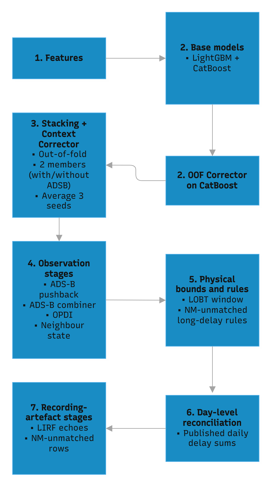

# Design

This document explains how our taxi-out model for the 2026 PRC / OpenSky Network Data Challenge
is put together, and the reasoning behind its main choices. Instructions for rebuilding the
submission are in [REPRODUCE.md](REPRODUCE.md). The full experiment log, including all the
faield attempts, is in [PROGRESS.md](PROGRESS.md).

## Problem

Predict `TAXITIME_SEC_mvt` (taxi-out time, in seconds) for departures, scored by RMSE.

- **Training data:** every movement (arrivals and departures) at 11 European airports in 2025.
- **Ranking data:** January and July 2026, plus February and June 2026 for the final ranking.
  On departures, `BLOCK_TIME_UTC_mvt` and `TAXITIME_SEC_mvt` have been removed.

## Core insight: retrospective reconstruction

The takeoff time (`MVT_TIME_UTC_mvt`) is still there in the ranking data, and all the arrivals
are complete. So the task isn't forecasting taxi-out before the aircraft pushes back; it's
working out after the fact what must have happened. For each departure, the following are
already known:

- `T`: take-off time;
- `S`: scheduled time to leave the stand;
- the off-block times the Network Manager (NM) planned and recorded (LOBT, EOBT, `AOBT_3`);
- everything else going on at the airport at the time: other takeoffs, landings, which stands
  were in use.

Taxi-out is just `T − AOBT`, so the problem comes down to estimating one missing timestamp, the
off-block time, with a lot of context around it. Two things follow from this:

- **A lot of the information is in the planned times and in the delay `T − S`.** The pushback
  delay `d = AOBT − S` is often easier to model than the taxi time itself, and one converts
  exactly into the other: `taxi = (T − S) − d`.
- **The model is meant for looking back at operations.** It relies on the actual takeoff time,
  so it can't be used to predict taxi-out ahead of time, before the aircraft has pushed back.

## Hard invariant: split-blind features

The code that builds features never gets to see a departure's off-block time or its taxi label:

- `BLOCK_TIME_UTC_mvt` and `TAXITIME_SEC_mvt` are set to null on every departure, in both the
  training and ranking data, before any feature code runs.
- The labels are kept in a separate table keyed on `MVT_ID_mvt`, and are only joined in when a
  model is being trained.
- `build_features()` takes a single dataframe in the ranking format, so it has no way to leak
  the answer.

Every later stage that adds inputs sticks to the same rule: it can only use things that also
exist for the 2026 rows.

## Architecture

### 1. Features

These are built by `src/features/build_features.py` and `src/features/neighbour_feats.py`, and
none of them use labels. The main groups are:

- **Physical baseline:** typical taxi-out times when there's no queue (low percentiles), per
  stand group, runway, aircraft type and wake category.
- **Traffic around the takeoff time:** how many departures and arrivals there were in the
  minutes around it, the gaps between departures, and stretches where the runway was running
  at full capacity.
- **Runway configuration:** which runways were in use, worked out for each 5-minute window, and
  how long it had been since the configuration last changed.
- **Rotation and schedule:**
  - the inbound flight, matched through stand occupancy (`src/link/stand_link.py`; 99.9% of
    departures get a match);
  - how late the inbound was, and the scheduled and actual time on the ground;
  - how far apart the various planned and recorded off-block times are (LOBT, EOBT, IOBT,
    `AOBT_3`).
- **Weather (METAR):** wind, visibility, precipitation and temperature. Temperature mostly
  matters because it signals when de-icing is likely.
- **Neighbouring flights:** what other flights around the same time and on the same runway look
  like, for example how wrong their recorded off-block was, how late they were, and how much
  longer than usual arrivals took to taxi in.
- **Categorical and calendar** features.

### 2. Base models

- **LightGBM and CatBoost**, each trained on all ten airports together.
- **Mixed target.** At LIRF (Rome) the model predicts the pushback delay `d`, which is then
  converted back to taxi time. Everywhere else it predicts taxi time directly.
- **Echo classifier.** In some records the block time is just a copy of the scheduled time, so
  the recorded taxi time ends up containing the whole departure delay. We call these "echoes",
  and most of them are at LIRF. A classifier gives each row a probability `p` of being an echo,
  and the prediction is the blend `p·(T − S) + (1 − p)·model`.

### 3. Correctors

- **CatBoost corrector.** A small LightGBM (with Huber loss) learns the mistakes CatBoost tends
  to make. Its trained on out-of-fold predictions, meaning predictions CatBoost made for months
  it wasn't trained on.
- **Stack.** LightGBM and the corrected CatBoost are combined with non-negative weights.
- **Context corrector** (`src/post/ctx_armc.py`). Another LightGBM, this time on the stack's
  remaining error. It's also trained only on out-of-fold predictions, and uses label-free
  context such as:
  - the stand prefix, and statistics for similar flights from other months;
  - whether the NM times agree with each other;
  - what the runway was doing and whether the stand was re-used soon after;
  - summaries over the surrounding hour, and runway activity over several window lengths;
  - the flow of traffic at the time.

  There are two versions, and one of them also uses ADS-B inputs. The ADS-B version is only
  used at the four airports where ADS-B coverage looks about the same in 2025 and 2026 (EHAM,
  LSZH, EDDF, LEBL). The final corrector is the average of three fits with different random
  seeds.

### 4. Observation stages

- **ADS-B pushback.**
  - A detector (`src/link/adsb_pushback.py`) looks for the moment the aircraft leaves its stand
    in the adsb.lol ground tracks. It uses stand positions from the X-Plane Scenery Gateway,
    plus 50 positions inferred from ADS-B for stands the Gateway doesn't have.
  - A second model then combines the detected pushback with the model's prediction, on rows
    where ADS-B data is available.
  - We trained it on the 2025 holdout plus a sample of ADS-B days from every other month.
- **OPDI ground events** (from EUROCONTROL). These are used at LSZH and at EDDF, where coverage are good. At EDDF their clock is off, so they are only used after subtracting each day's average.
- **Neighbour-state corrector.** For rows without ADS-B, this looks at the errors on nearby
  flights that can be observed. Its average correction per airport and UTC day is subtracted,
  so it only moves errors around within a day.

### 5. Physical bounds

The predicted off-block is clipped so that `|BLOCK − LOBT| ≤ 3,606 s`. Every 2025 departure
with a LOBT stayed inside this window.

NM-unmatched departures that are more than 6 hours late follow simple lines fitted on `T − S`.
Outside LIRF these lines are taken back out again, because the corrector does better on those
rows.

### 6. Day-level reconciliation

For each airport and day, EUROCONTROL publishes:

- the total pre-departure delay, Σ max(0, AOBT − SOBT);
- the number of departures.

In 2025 these totals match the sum of our labels. So for 2026 the pipeline:

1. works out, for each airport-day, the shift λ that makes the predictions add up to the
   published total;
2. splits that shift between the flights, using a model fitted on 2025 that decides how much
   each flight should move (based on its delay band, hour, whether it has ADS-B or OPDI data,
   and how big λ is).

LSZH has its own version of this step. LIRF is left out. We tried using the daily totals at
LIRF to estimate each row's echo probability, but it didn't hold up, so it was dropped.

### 7. Recording-artefact stages

These deal with how the ranking labels were recorded, rather than with taxiing itself. Most of
them are about LIRF departures that the Network Manager couldn't match (NM-unmatched). For those
rows the label usually turns out to be one of a few things:

- a copy of the schedule (an echo);
- a real pushback;
- a block time written down in local time instead of UTC (+1 h in winter, +2 h in summer);
- a date that is one day off.

What these stages do:

- estimate how likely each of those cases is for each row, using only label-free clues:
  - the published daily departure counts;
  - arrival "twins" that limit when the off-block could have happened;
  - how often that airline had echoes in 2025;
  - the format of the flight number;
- then predict the average outcome, weighted by those probabilities.

The rule for each case is fitted on 2025 and checked one month at a time.

## Key decisions and rationale

**Mixed target.** Predicting the delay `d` works better where the label is tied to the schedule
(LIRF's echoes and long delays). Predicting taxi time directly works better where taxi time is
mostly about physically getting to the runway. On the holdout, predicting taxi directly beat
predicting delay at 8 of the 10 airports, but did clearly worse at LIRF. The mixed model was as
good as the better of the two at every airport. HOwever, a feature can help one target and
hurt the other, so we tested every change with the mixed target, since that's the one submitted.

**Every second-stage model is trained out-of-fold.** A corrector trained on the base model's
predictions for data it has already seen underestimate errors. So every second-stage model is trained on predictions the base model made for
months it was not trained on, including:

- the CatBoost corrector;
- the context corrector;
- the ADS-B combiner;
- the neighbour stage.

Inside each fold, the priors, encodings and early stopping also leave out the held-out month.

**Errors come in clusters.** Departures close together in time tend to be wrong in the same way,
because they were hit by the same disruption, de-icing or runway closure. That led to three
stages:

- the neighbour-state stage, which uses label-free signals from nearby flights;
- the time-window features in the context corrector;
- the day-level reconciliation, which uses the one label total that is published for 2026.

The neighbour stage has its daily average removed per airport, so it can shift error between
flights on the same day but can't change an airport's overall level. Only the day-level stage,
which is tied to published numbers, is allowed to do that.

**ADS-B coverage changed between 2025 and 2026.** At several airports it changed a lot (more
receivers came online; LEMD, EGLL and LIRF moved in opposite directions). Models that learned
airport-specific ADS-B behaviour from the patchy 2025 data didn't carry over well. So:

- anything that depends on ADS-B is only used where coverage is similar in both years;
- there are no separate ADS-B models per airport;
- every new input is checked for differences between 2025 and 2026 before it is accepted.

**A few labels drive most of the RMSE.** Some labels are hours long, because of date mistakes,
echoes or simply just bad days. A handful of those can decide which of two models looks better on
the holdout. Therefore:

- changes are judged on a fixed trimmed score (labels up to 5 h) and on the "body" rows
  (NM-matched, up to 1 h), with the full RMSE kept as a safety check;
- where a label can only be one of a few cases, the prediction is the probability-weighted
  average. With squared error, that does better than betting on a single case.

**Recording quirks are part of the target.** The LIRF echoes and the long-delay NM-unmatched
rows make up a big part of the squared error, and no model of real taxiing could predict them.
Treating them as quirks of how the data was recorded, with rules fitted on 2025 and checked on
months they weren't fitted on, helped more than making the models bigger.

**Add changes on top instead of rebuilding.** Refitting is non-deterministic as two CatBoost GPU runs can
differ by about 27 s RMS. So each new stage is built as the difference between a run with the
change and a run without it, fitted in the same process, and that difference is added to the
previous best file. For rows where a change didn't carry over to 2026, we kept their old values. In
particular, LIRF NM-matched rows were frozen after the earlier LIRF fixes. Hence, averaging the
corrector over three seeds is for the same reason, it makes each of these differences less
noisy.

**Stand linking is useful for features, not for limits.** We found out that matching each departure to its inbound
aircraft should give a window for the off-block, after the inbound arrived at the stand, and
before the next aircraft did. The window does hold (only 0.1% of high-confidence matches fall
outside it), but it's typically about 14 times wider than the spread of taxi times, so it
doesn't narrow anything down. The matching was kept for the rotation features, like inbound
delay and time on the ground.

**How we used the leaderboard.** Every change had to pass on the 2025 holdout first, and for most
of them the expected outcome was written down before seeing the result
(`reports/*_preregistration.md`). A change that passed was uploaded with a keep-or-drop rule
decided in advance. Leaderboard scores were only used for that yes/no decision, never to tune
values, weights or scales.

## Validation

- **Holdout:** January + July 2025, with models trained on the other ten months. These months
  are the same seasons as the ranking period.
- **No random k-fold:** flights close together share the same traffic conditions, so random
  folds would let that information leak.
- **Holdout is built on its own** the holdout features are built from just those two months, so
  the gap in the ranking data's timeline (and any features that reach across it) behaves the
  same way in validation.
- **Uncertainty:** a paired bootstrap that resamples whole (airport, day) groups
  (`tests/_harness.py`).

## Compute and conventions

- We worked on two laptops with the same spec: Intel Core Ultra 7 155H (16 cores / 22 threads) + 
  32 GB RAM + Windows 11 + integrated Intel Arc graphics  and NVIDIA Blackwell Pro 1000 (not used for training). GPU work (CatBoost) ran on free-tier Google Colab (NVIDIA T4). The features were built with Polars, and
  LightGBM ran on CPU. 
- Seeds are fixed, and LightGBM runs with `deterministic=true` and `force_row_wise=true`.
- The fetch scripts and some small derived tables are in the repo, whereas caches stay local and can be rebuilt
  from source.
- Every external source has a row in [DATA_SOURCES.md](DATA_SOURCES.md): name, URL, licence,
  date accessed, the artefact derived from it, and the script that fetches it.
